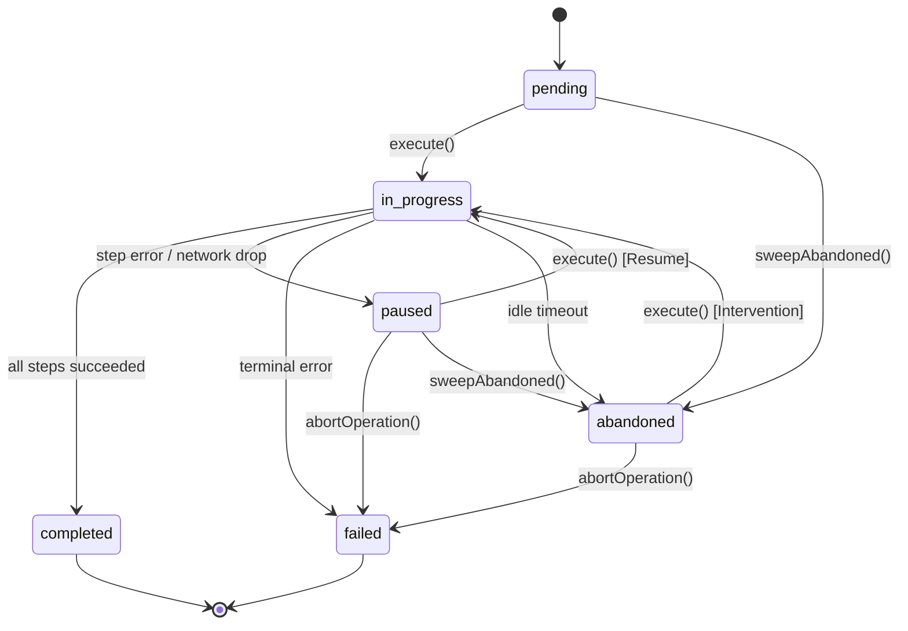
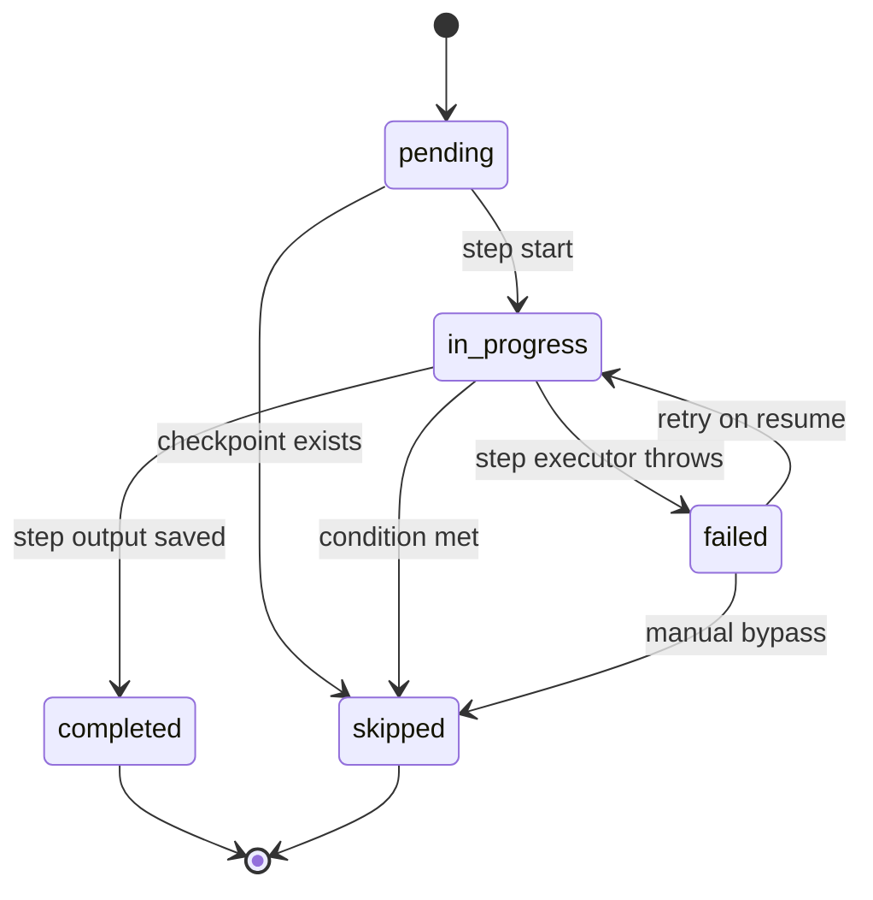

# Formal Lifecycle State Machine & Transition Rules

## Overview

The Trellis Frontend Lifecycle State Machine (`lib/recovery/state-machine.ts`) governs the execution, terminal completion, interruption, and recovery of multi-step operations (e.g. Agent minting, Soroban transactions, staking, and data pipelines).

It guarantees that:
1. **Explicit Transitions**: Every valid transition is strictly mapped in immutable transition tables.
2. **Deterministic Error Handling**: Illegal transitions throw `InvalidStateTransitionError` containing the source state, target state, entity identifier, and permitted target states.
3. **Terminal Immutability**: Terminal states (`completed`, `failed`) are permanent and immutable.
4. **Governed Recovery Paths**: Recovery paths (`paused -> in_progress`, `abandoned -> in_progress`) are explicitly validated to prevent race conditions and duplicate execution.

---

## State Definitions

### Operation States (`OperationStatus`)

| State | Classification | Description |
|---|---|---|
| `pending` | Initial | Operation initialized and registered in the store, awaiting execution |
| `in_progress` | Active | Operation is currently executing one of its steps |
| `paused` | Recoverable | Execution interrupted (network error, user cancellation) at a step boundary; ready for resume |
| `abandoned` | Recoverable | Inactive beyond `abandonAfterMs` window; eligible for maintainer recovery or dismissal |
| `completed` | **Terminal** | All steps successfully executed; side-effect checkpoints committed |
| `failed` | **Terminal** | Operation permanently failed or aborted; non-retryable |

---

## State Transition Diagrams

### Top-Level Operation Lifecycle



### Step Lifecycle



---

## Operation Transition Matrix

| From \ To | `pending` | `in_progress` | `paused` | `completed` | `failed` | `abandoned` |
|---|:---:|:---:|:---:|:---:|:---:|:---:|
| **`pending`** | Idempotent | **Legal** | ❌ | ❌ | ❌ | **Legal** |
| **`in_progress`** | ❌ | Idempotent | **Legal** | **Legal** | **Legal** | **Legal** |
| **`paused`** | ❌ | **Legal (Resume)** | Idempotent | ❌ | **Legal (Abort)** | **Legal** |
| **`abandoned`** | ❌ | **Legal (Recover)** | ❌ | ❌ | **Legal (Abort)** | Idempotent |
| **`completed`** | ❌ | ❌ | ❌ | Idempotent | ❌ | ❌ |
| **`failed`** | ❌ | ❌ | ❌ | ❌ | Idempotent | ❌ |

> **Note**: Self-transitions (e.g. `pending -> pending`) are treated as idempotent no-ops.

---

## Step Transition Matrix

| From \ To | `pending` | `in_progress` | `completed` | `failed` | `skipped` |
|---|:---:|:---:|:---:|:---:|:---:|
| **`pending`** | Idempotent | **Legal** | ❌ | ❌ | **Legal** |
| **`in_progress`** | ❌ | Idempotent | **Legal** | **Legal** | **Legal** |
| **`failed`** | ❌ | **Legal (Retry)** | ❌ | Idempotent | **Legal (Bypass)** |
| **`completed`** | ❌ | ❌ | Idempotent | ❌ | ❌ |
| **`skipped`** | ❌ | ❌ | ❌ | ❌ | Idempotent |

---

## Deterministic Error Structure

When an invalid transition is attempted, the engine throws an `InvalidStateTransitionError`:

```ts
import { InvalidStateTransitionError } from '@/lib/recovery/state-machine';

try {
  transitionOperation(completedOp, 'in_progress');
} catch (err) {
  if (err instanceof InvalidStateTransitionError) {
    console.error(err.message);
    // Invalid operation transition from 'completed' to 'in_progress' for operation 'op-123'. Terminal state: no further transitions permitted.
    console.log(err.fromStatus);         // 'completed'
    console.log(err.toStatus);           // 'in_progress'
    console.log(err.allowedTransitions); // []
  }
}
```

---

## Operational Edge Cases & Failure Modes

1. **Terminal State Revocation Attempt**:
   - *Scenario*: An external webhook arrives late reporting a failure after the operation has already reached `completed`.
   - *Behavior*: `validateOperationTransition` halts execution with `InvalidStateTransitionError`. The terminal `completed` state cannot be mutated.
2. **Concurrent Tab Resumption**:
   - *Scenario*: Two browser tabs attempt to resume a `paused` operation simultaneously.
   - *Behavior*: Tab 1 transitions status from `paused -> in_progress`. Tab 2 detects `op.status === 'in_progress'` and returns concurrency guard error without executing side effects.
3. **Step Checkpoint Desynchronization**:
   - *Scenario*: Browser crashes immediately after writing a side-effect checkpoint to storage before `status: 'completed'` is written to memory.
   - *Behavior*: On resumption, the recovery engine inspects checkpoints directly. Since the checkpoint exists, the step is treated as committed and skipped forward.

---

## Verification & Test Suite

All 36 operation transition pairs and 25 step transition pairs are tested in the automated suite:

```bash
npm test -- tests/__tests__/lifecycle-state-machine.test.ts
```
